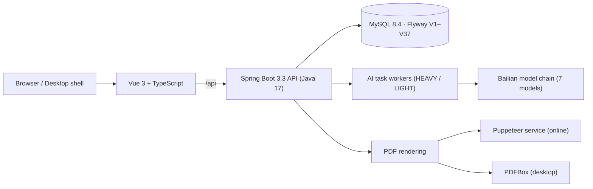

# Zhili · Resume Builder

A job-tailored resume platform for job seekers. You maintain one reusable career material library, pick a target job description, and the system selects which materials to use — **with your confirmation** — before generating an editable, traceable, structured resume.

The design principle is the opposite of a one-click resume beautifier: **verifiable material first, resume second**. Every bullet in the output must point back to a material item you approved; the model chooses and phrases, it does not invent.


## What it does

- **Career material library** — 13 kinds of reusable material (work, projects, skills, quantified achievements, single-skill evidence cards, …).
- **JD analysis and material selection** — keyword extraction plus rule pre-filtering, then an LLM explains what it picked, what it skipped, and which requirements stay uncovered.
- **Structured resumes** — seven templates sharing one layout engine; content, layout and template are independent.
- **Versioning** — every save creates a new version; archive, restore and compare are supported, and the current version cannot be archived.
- **Private PDF export** — rendered by a dedicated service online, or purely in Java (PDFBox) in desktop mode; export requires password re-verification.
- **ATS check** — rule-based scoring plus optional AI analysis. When the model is unavailable, rule results still render and the degradation reason is shown explicitly.
- **Application tracking** — a nine-state machine with full status history, follow-up reminders and conversion statistics.
- **Communication drafts and mock interviews** — grounded in confirmed material, with consent-gated AI calls.

## Architecture



| Layer | Choice |
| --- | --- |
| Frontend | Vue 3, TypeScript, Vite |
| Backend | Spring Boot 3.3.2, JPA, Flyway, Java 17 |
| Database | MySQL 8.4 (schema authority) / H2 file (desktop) |
| PDF | Puppeteer service · PDFBox 2.0.32 |
| Deployment | systemd + nginx, direct (no Docker) |

## Quick start

Online demo: **<http://101.35.239.218:8088/>** (a resettable test environment — do not store real personal data).

Local development (three processes):

```bash
cd server && mvn spring-boot:run -Dspring-boot.run.profiles=local-mysql   # :8080
cd web && npm install && npm run dev                                      # :5173
cd pdf-service && npm install && npm start                                # :3001
```

Desktop mode (single process, no login, local H2 file database):

```bash
java -jar intelligent-resume-server-0.4.2.jar \
  --spring.profiles.active=desktop --server.port=8082 --server.address=127.0.0.1
```

## Quality

Backend: **1019 tests passing**, including integration tests that run every Flyway migration. Every quality gate is validated against a known-bad sample first — a check that can never fail is treated as worse than no check (version-copy consistency, a per-file line-count ratchet, API-doc coverage, schema-doc contract, dual-dialect migration gates).

## Docs

- [Project context](PROJECT_CONTEXT.md) · [Docs index](docs/README.md)
- [Architecture](docs/03-系统架构设计说明书.md) · [API](docs/05-接口设计说明书.md) · [Deployment](docs/08-部署与运维说明书.md)
- [Decisions](docs/decisions/) · [Release notes v0.4.1](docs/RELEASES/v0.4.1.md)

中文版：[README.md](README.md)
