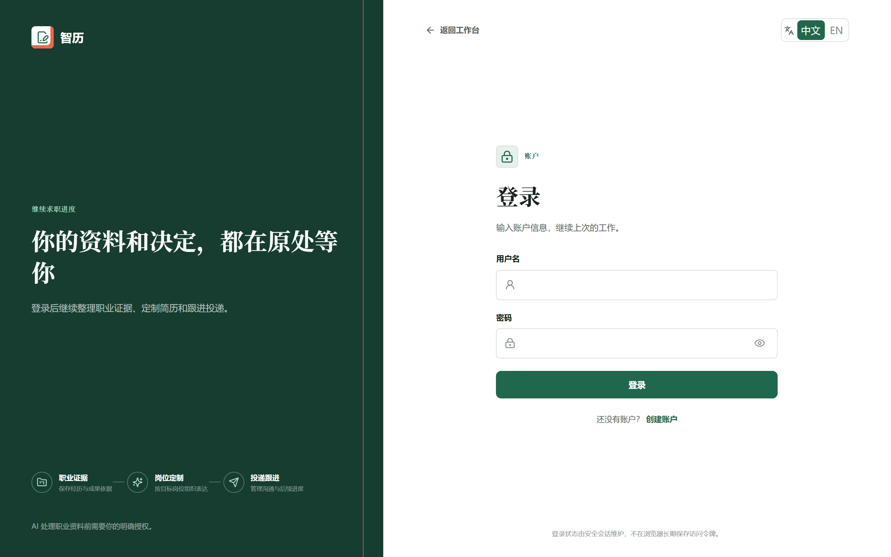
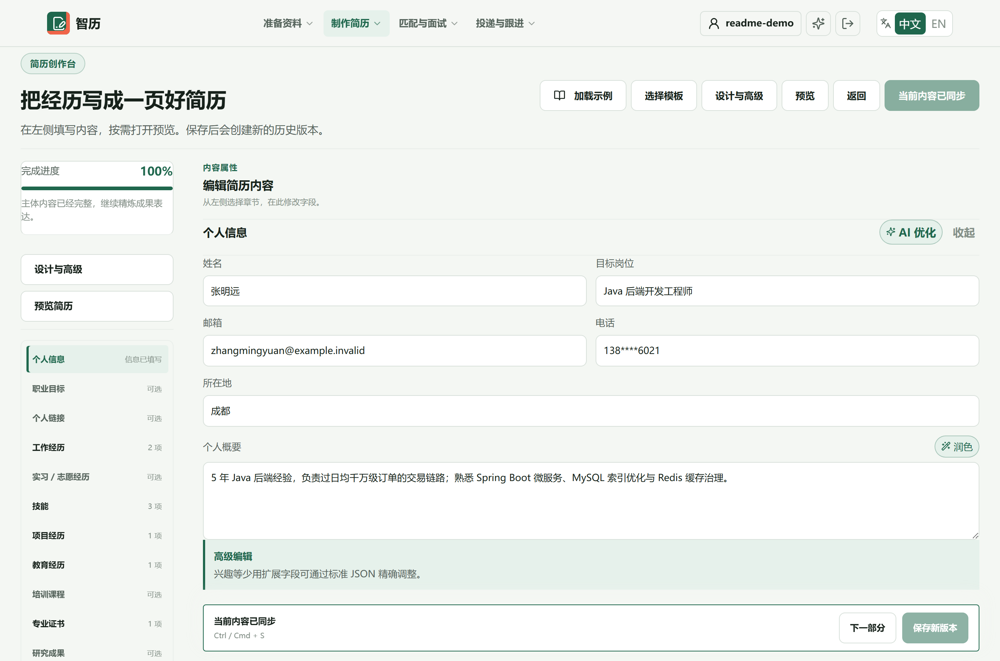
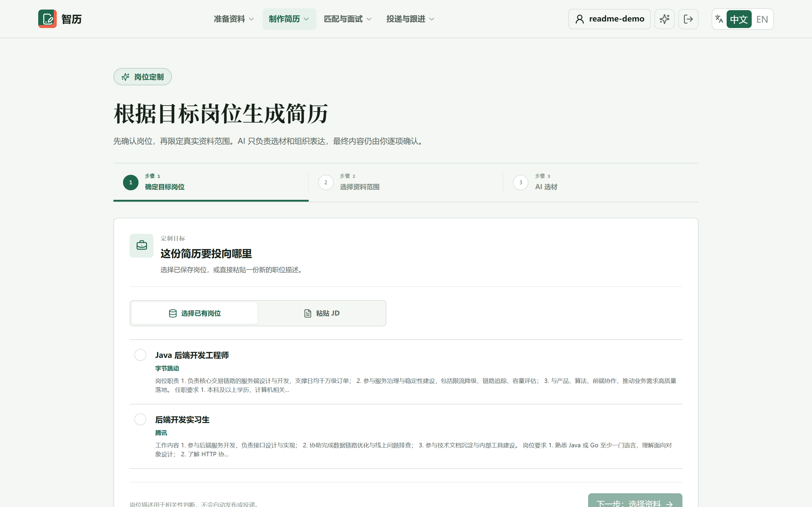
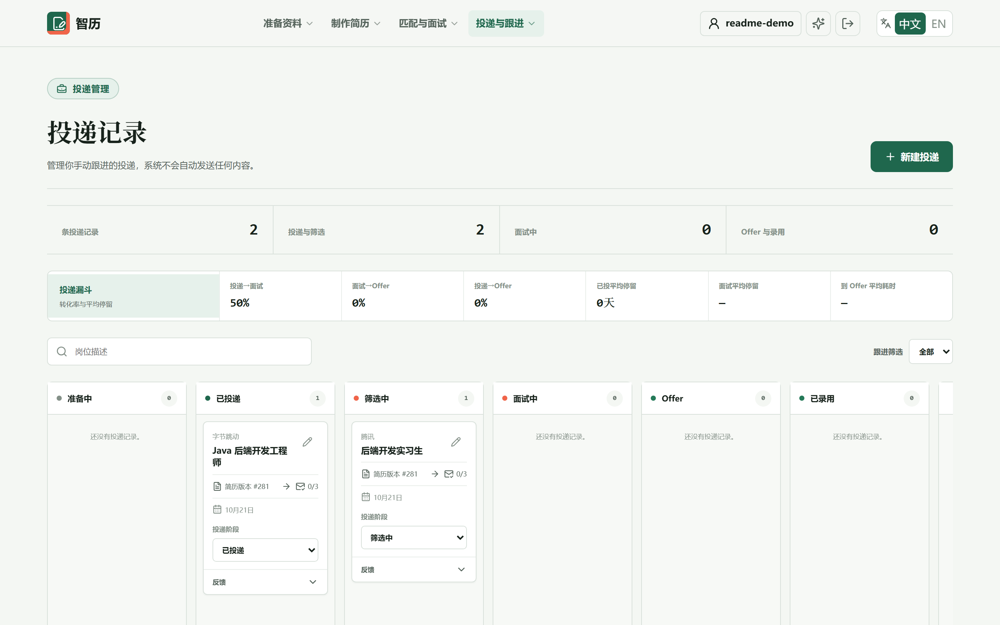
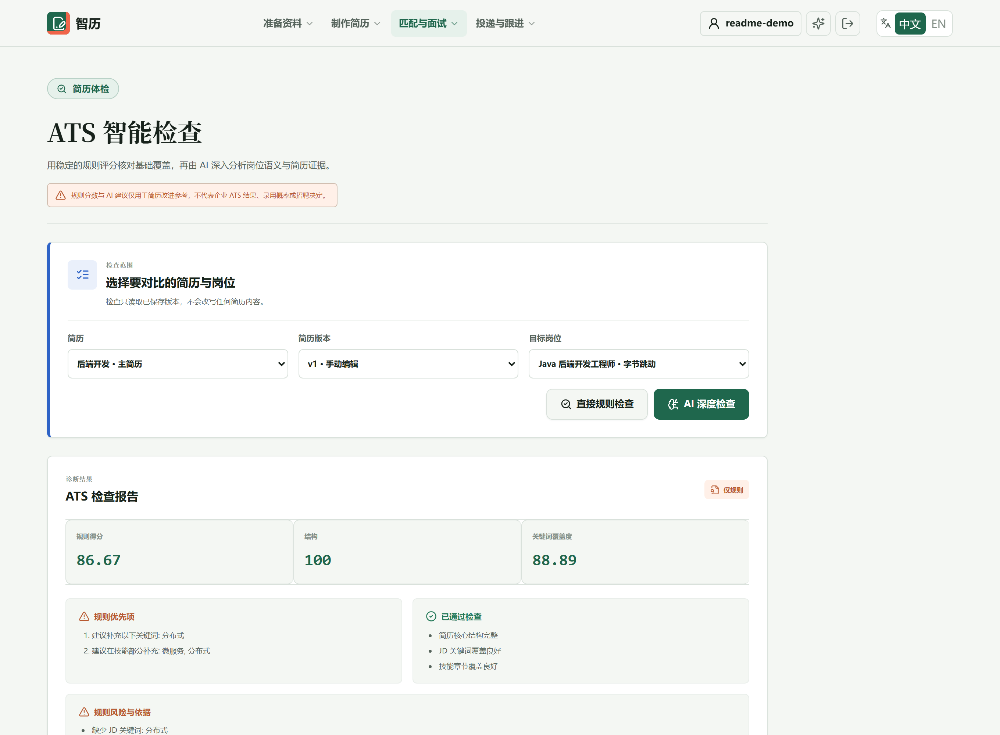
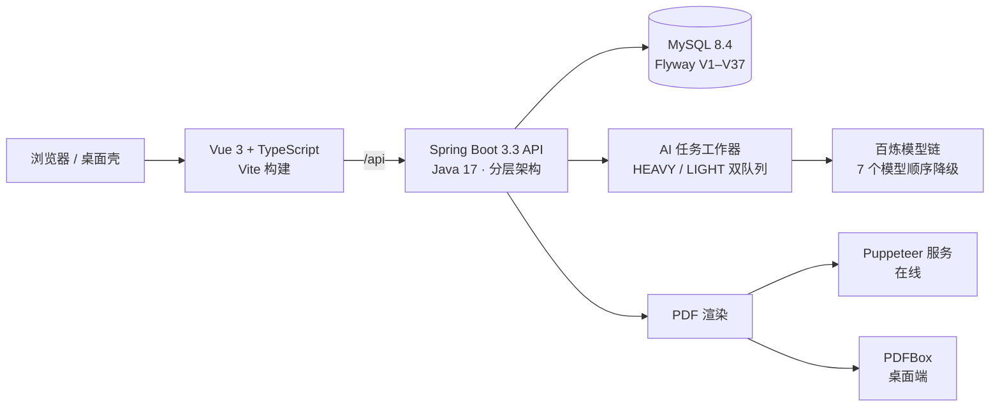

# 智历

面向求职者的**岗位定制简历平台**。你维护一份可复用的个人档案与职业资料库，选定目标 JD 后，系统先用真实大模型做资料选材、由你确认，再生成可编辑、可追溯的结构化简历——AI 负责选材与表达，**最终决定权始终在你手上**。




---

## 为什么做这个

市面上的简历工具大多是一条"上传 → 一键美化"的黑箱：它改写你写不清楚的地方，也改写你本来写对的地方；改完之后你既不知道它加了什么，也没法证明那句话真发生过。

智历的设计反过来——**先有可追溯的真实资料，再有简历**：

- 简历里的每一段经历都必须能指回你确认过的资料条目；
- AI 只做两件事：挑资料、组织表达，**不编造事实**；
- 每次保存都产生独立版本，归档、恢复、对比都可回退；
- 投递之后的状态、沟通草稿、面试复盘接在同一条链路上，而不是散在几个工具里。

## 产品一览

以下截图取自 [在线测试环境](http://101.35.239.218:8088/) 的真实运行状态（v0.4.1）。

### 求职工作台

进入后先看"下一步该做什么"，而不是一堆待填表单。最近编辑的简历、待跟进的投递、AI 授权状态都收在这一页。


### 简历创作台

左侧章节导航实时显示完成度，右侧逐字段编辑。内容、版式、模板三者分离：换模板不会动内容，改内容也不会打乱版式。



### 岗位定制生成

三步走：锁定目标岗位 → 限定可用资料范围 → AI 选材并给出理由。**未经你确认的资料不会进入生成链路**，未覆盖的岗位要求也会如实列出。



### 投递看板

投递状态机从草稿一路走到入职，共 9 态；每次状态迁移都写入状态历史（`from` / `to` / `note` / 时间），可以回看这条投递究竟发生过什么。看板同时给出转化率与各阶段平均停留天数。



### ATS 检查

先用稳定的本地规则核对结构完整性与关键词覆盖度，再由 AI 深入分析岗位语义与简历证据。规则分与 AI 建议分开呈现，**规则结果不依赖 AI 可用性**——模型挂了也不会让检查变成空白。



## 核心能力

| 能力 | 说明 |
| --- | --- |
| 个人档案与职业目标 | 联系方式、简介、目标职位、职级、行业与工作方式偏好，一次维护多处复用 |
| 职业资料库 | 工作、项目、教育、技能、证书、量化成果、管理经历、单技能证据卡等 13 类可复用资料 |
| JD 解析与选材 | 关键词抽取 + 规则预筛，再由 AI 给出推荐理由、未采用原因与未覆盖要求 |
| 结构化简历 | 七套模板共享同一套排版引擎；联系方式由服务端合并，量化成果按展示口径脱敏 |
| 版本管理 | 每次保存生成新版本，支持归档、恢复、跨版本对比，当前版本受保护不可归档 |
| 私有 PDF 导出 | 在线走独立渲染服务，桌面端走纯 Java 渲染；导出前需二次验证密码 |
| ATS 检查 | 规则评分与 AI 分析双通道，AI 不可用时自动降级并明确告知原因 |
| 投递闭环 | 9 态状态机 + 状态历史 + 跟进提醒 + 转化率统计 |
| 沟通草稿 | 基于已确认事实生成求职信、邮件与开场白，附情绪与事实边界校验 |
| 模拟面试 | 有限轮次问答、逐题评估、复盘报告与答案资产沉淀 |
| Windows 桌面模式 | 本地 H2 文件库、免登录、纯 Java PDF，数据不出本机；工作区快照备份/恢复与 Web 导出包导入都在「桌面工作区」页面完成（在线版不显示该入口） |

## 技术架构



| 层 | 选型 | 版本锚定 |
| --- | --- | --- |
| 前端 | Vue 3 + TypeScript + Vite | Vue 3 / Element Plus |
| 后端 | Spring Boot + JPA + Flyway | 3.3.2 / Java 17 |
| 数据库 | MySQL（生产权威）/ H2 file（桌面） | 8.4 / 2.x |
| PDF | Puppeteer 渲染服务 · PDFBox 本地渲染 | Node 20+ / PDFBox 2.0.32 |
| 部署 | systemd + nginx 直连部署（无 Docker） | — |

几条贯穿全局的工程约定：

- **schema 权威只有一份**：MySQL 8.4 上跑通全部迁移才算数，桌面端 H2 跟着它走；
- **AI 一律异步**：长任务进工作队列，前端拿 `taskId` 轮询，避免"提交后干等两分钟"；
- **AI 调用受同意约束**：没有用户显式授权，不把简历内容发往模型；
- **失败必须可见**：AI 降级、超时、授权不足都会在界面上说清原因，而不是静默返回空结果。

## 快速开始

### 在线体验

直接打开 **<http://101.35.239.218:8088/>**，注册即可（用户名 + 邮箱 + 密码，无需邮箱验证）。

> 这是**可随时重置的测试环境**，不要放真实隐私数据；AI 相关功能需要环境侧配置模型密钥。

### 本地开发（三个进程）

前置：Java 17、Maven 3.9+、Node.js 20+、本地 MySQL 8。复制 `.env.example` 为 `.env` 并填写数据库连接，在 `.env.live-ai` 中配置 `BAILIAN_API_KEY`（不配则 AI 功能降级、规则功能不受影响）。

```bash
# 1. 后端 API
cd server && mvn spring-boot:run -Dspring-boot.run.profiles=local-mysql
#    → http://localhost:8080/api/system/health

# 2. 前端
cd web && npm install && npm run dev
#    → http://localhost:5173

# 3. PDF 渲染服务
cd pdf-service && npm install && npm start
#    → http://localhost:3001/health
```

`PDF_SERVICE_TOKEN` 需在根 `.env` 与 `pdf-service/.env` 两侧保持一致。Windows 上也可用 `.\scripts\Start-LocalValidation.ps1` 一键拉起三个服务（详见 [本地验证指南](docs/LOCAL_VALIDATION.md)）。

### 桌面模式（单进程、免登录）

```bash
java -jar intelligent-resume-server-0.4.1.jar \
  --spring.profiles.active=desktop \
  --server.port=8082 --server.address=127.0.0.1
```

打开 <http://127.0.0.1:8082> 即进入本地工作区：H2 文件库落在 `./desktop-data`，PDF 由纯 Java 渲染（不依赖 Node 与 Chromium），无需登录。`--server.address` 必须是回环地址，否则服务**拒绝启动**——这是防止本地数据被局域网访问的护栏。

### 部署

```bash
bash scripts/deploy-direct.sh
```

本机打包源码 → 上传 → 服务器端构建 → 同步产物 → 重启服务 → 自动执行 17 项部署后探针（安全头、配置一致性、监听范围、模型链一致性等）。**探针失败脚本以非零码退出**，不会给出"部署成功"的假结论。详见 [直连部署手册](docs/DEPLOYMENT_DIRECT.md)。

## 工程结构

```text
server/            Spring Boot API（分层：controller / service / repository / domain）
  └─ db/migration/ Flyway 迁移 V1–V37
web/               Vue 3 + TypeScript 前端（views / components / api / stores）
pdf-service/       Node.js + Puppeteer 私有 PDF 渲染服务
scripts/           部署、探针、持久化门禁、全流程验证
functional-tests/  黑盒功能回归（4 套件）
docs/              产品、架构、接口、测试、运维与决策记录
deploy/            nginx 站点配置与 systemd 单元（随部署幂等同步）
```

## 质量与验证

当前基线：**后端 1019 个测试全绿**（含集成测试真跑全部 Flyway 迁移）、前端构建与浏览器 E2E、PDF 服务用例，以及部署后 17 项探针与 18 项状态机探针。

比"测试数量"更值得说的是——这个仓库对**门禁本身**下了功夫，因为"永远返回通过"的检查比没有检查更危险：

| 门禁 | 拦的是什么 |
| --- | --- |
| 版本号一致性 | 同一版本号有 11 处独立副本（含 jar 名），任一处不一致即红 |
| 单文件行数棘轮 | 生产代码 ≤300 行、测试代码 ≤400 行；超限文件必须登记并锁定上限，只许下调；每个扫描根单独校验扫描下限，任一根扫空即失败（防门禁空转） |
| API 文档覆盖 | 新增端点未写入接口文档即红 |
| Schema 文档契约 | 新增表未写入数据库文档即红 |
| 持久化双口径 | MySQL 8.4（全新安装）与 5.7（存量升级）分别真跑迁移，退出码区分"未测量"与"通过" |
| 状态矩阵三方一致 | 后端枚举 / 前端数组 / 文档表格逐格比对 |

每个门禁都用**已知坏样本**验证过它会失败；验证不了的检查不会进主干。

## 已知边界

- **AI 能力需要模型密钥**。未配置时 AI 链路降级为规则结果，界面会明确标注降级原因，不会假装成功。
- **导入范围**覆盖 4 类核心集合（简历、职业资料、JD、投递）及其嵌套子集合（简历版本、状态历史），逐条分类、逐条解决冲突。边界：本地已有同编号版本时该版本跳过并提示（不改动本地数据）。
- **桌面端**已有本地库、备份恢复、纯 Java PDF、本地 AI 设置（密钥 DPAPI 加密）与 `desktop-shell/` 壳骨架；**仍无安装包**（electron-builder/NSIS 未做），Electron 窗口本身也还没在有人值守的图形会话里验过。「本地 AI 设置」已接入任务链路（保存即生效，关闭/删除回落配置文件）。
- 单用户单工作区，**不支持团队协作与多租户**。

## 文档

- [项目上下文](PROJECT_CONTEXT.md)（新人与 AI 协作的第一入口）
- [文档索引](docs/README.md)
- [系统架构设计](docs/03-系统架构设计说明书.md) · [数据库设计](docs/04-数据库设计说明书.md) · [接口设计](docs/05-接口设计说明书.md)
- [测试计划与验收](docs/07-测试计划与验收说明书.md) · [部署与运维](docs/08-部署与运维说明书.md)
- [架构决策记录](docs/decisions/) · [悬而未决登记册](docs/decisions/OPEN-DECISIONS.md)
- [发布说明 v0.4.1](docs/RELEASES/v0.4.1.md)

English: [README.en.md](README.en.md)
